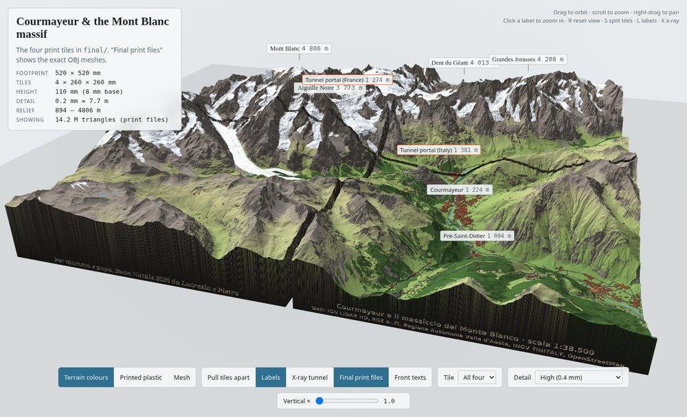
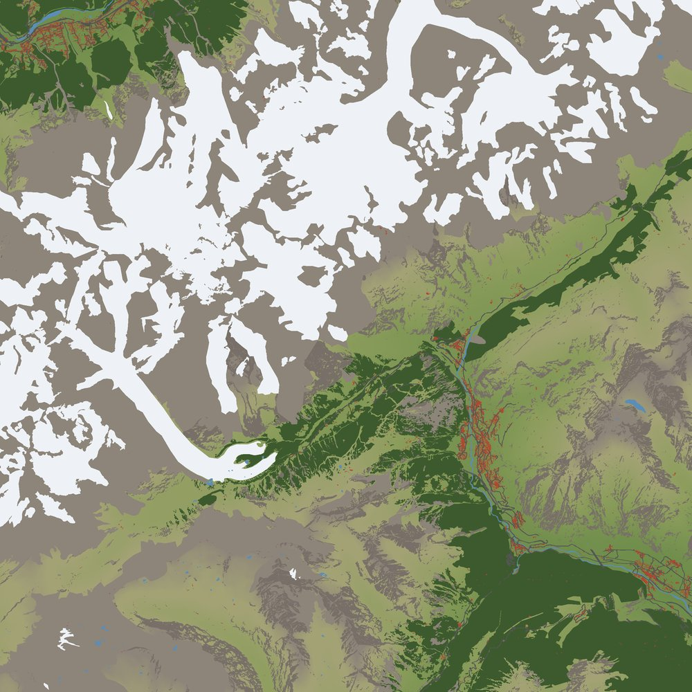
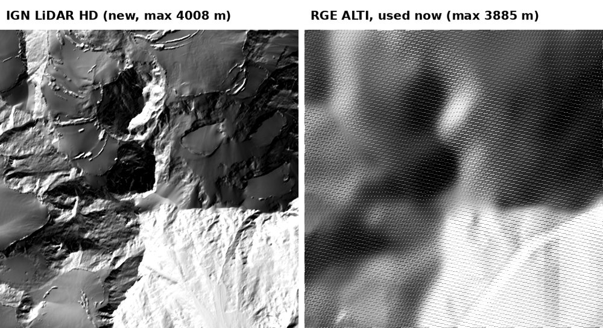

# Courmayeur & the Mont Blanc massif — 3D terrain model

A printable 52 × 52 cm relief model of Courmayeur, the Italian side of Mont Blanc and the
Chamonix side up to the Aiguille du Midi, built from open lidar data. It is split into four
26 × 26 cm tiles and includes the Mont Blanc Tunnel, roads, buildings and engraved text.



| | |
|---|---|
| Ground covered | 20 × 20 km square, UTM 32N, centred 45.815 N 6.920 E |
| Model | 520 × 520 mm in four 260 × 260 mm tiles, 110 mm high, scale 1 : 38 462, true vertical scale |
| Detail | 0.2 mm grid (7.7 m on the ground) |
| Print files | hollow 1.5 mm shell with open bottom, ≈1 M triangles per tile |

## What's in the model

- **Terrain** from four elevation sources, merged with seamless blending:
  IGN LiDAR HD (France and the border summits), Regione Valle d'Aosta lidar (Italy),
  IGN RGE ALTI and INGV TINITALY as fallbacks, AWS Terrain Tiles for anything left.
- **Mont Blanc Tunnel** (11.6 km, OpenStreetMap route): a 2 mm bore cut through the NW and NE
  tiles, opening at both portals level with the access roads.
- **Roads and buildings** from OpenStreetMap: roads raised 0.3 mm, buildings at 3× height.
- **Engraved text** on the front (south) walls: a dedication and the data credits (`labels.py`).
- **Colours** (for full-colour printing and the viewer) from OpenStreetMap landcover:
  glaciers, forests, rock/scree, water, roads, buildings.



## Build

With [uv](https://docs.astral.sh/uv/) (recommended):

```bash
uv sync                          # creates .venv with the pinned versions from uv.lock

uv run fetch_data.py             # downloads ~1 GB of elevation + OSM data into data/ (skips what exists)
uv run build_tiles.py            # terrain, features, tunnel, hollowing, text -> results/tiles/ (full resolution)
uv run export_color.py           # upload-ready files -> results/final/, final_stl/, final_color/
uv run cnc_export.py             # optional: solid heightmaps + STL for a 3-axis CNC -> results/cnc/
uv run viewer/serve.py           # 3D viewer at http://localhost:8765/viewer/
```

Settings that are environment variables go in front, e.g. `SHELL_MM=2 uv run build_tiles.py`.
Run `export_color.py` again after every `build_tiles.py` so the upload files stay in sync.

Without uv:

```bash
python -m venv .venv && . .venv/bin/activate
pip install -r requirements.txt
python fetch_data.py && python build_tiles.py && python export_color.py
python viewer/serve.py
```

Settings are constants at the top of the scripts, some also as environment variables:
`SHELL_MM` (shell thickness, default 1.5), `HOLLOW=0` (solid tiles, e.g. for FDM),
`VERT_EXAG` (vertical exaggeration), `FEATURES=0` (no roads/buildings),
`TUNNEL_RADIUS_MM` (default 1.0).

The engraved text uses system fonts (Noto Serif Bold Italic, DejaVu Sans Bold); adjust the
paths at the top of `labels.py` if your system keeps them elsewhere.

## Folders

- `data/` — downloaded inputs (elevation models, OpenStreetMap extracts); not in git, recreate with `fetch_data.py`
- `results/` — everything generated; not in git, recreate with the build scripts

| Output folder | Contents | Use |
|---|---|---|
| `results/final_stl/` | binary STL per tile | single-colour printing (e.g. resin), hand painted |
| `results/final_color/` | 3MF and VRML with per-vertex colours | full-colour printing (PolyJet, sandstone…) |
| `results/final/` | OBJ per tile | single-colour printing |
| `results/cnc/` | 16-bit heightmaps, solid STL, README | 3-axis CNC (no tunnel bore) |
| `results/tiles/` | full-resolution meshes and viewer data | viewer, intermediate |

Each tile has its own origin at its south-west corner; +Y is grid north.

## Scripts

| Script | Purpose |
|---|---|
| `fetch_data.py` | download all inputs |
| `fetch_vda.py` | stream the 2.6 GB Aosta Valley lidar archive (Deflate64) and keep only the model area |
| `build_tiles.py` | merge elevation sources, Dent du Géant options, write tiles (hollow, bored, engraved) |
| `features.py` | stamp OSM roads and buildings into the height grid |
| `build_tunnel.py` | Mont Blanc Tunnel bore path, fitted to the portals and access roads |
| `labels.py` | engraved text on the front walls |
| `export_color.py` | landcover colours; simplified STL / OBJ / 3MF / VRML for upload |
| `cnc_export.py` | CNC heightmaps and STL |
| `viewer/` | local three.js viewer (`serve.py` + `index.html`) |

## Data sources and licences

- IGN — LiDAR HD and RGE ALTI, Licence Ouverte / Etalab 2.0
- Regione Autonoma Valle d'Aosta — DTM 2005/2008 lidar, CC BY
- INGV — TINITALY 1.1, CC BY 4.0
- OpenStreetMap — tunnel route, roads, buildings, landcover, © OpenStreetMap contributors, ODbL
- AWS Terrain Tiles (Mapzen / Tilezen), fallback only


